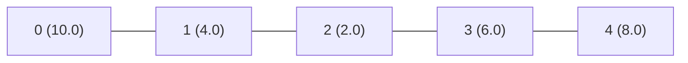
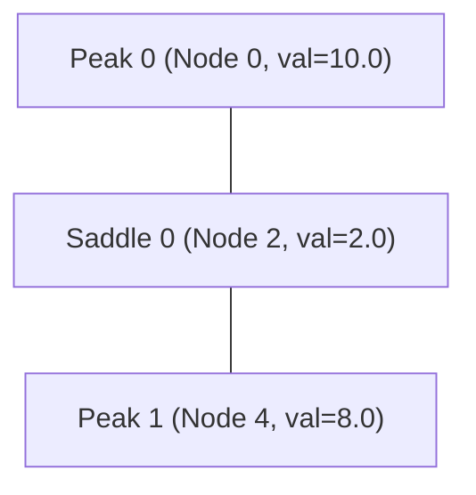

# Step-by-Step Walkthrough: Extremum Graph on a Toy Example

This document provides a line-by-line trace and numerical dry run of [`pipeline/extremum_graph.py`](file:///home/priyank1/Projects/GV_271/pipeline/extremum_graph.py) using a simple 5-node scalar field.

---

## 1. Setup & Toy Landscape

Consider a 1D discrete field sampled along a line graph with two hills separated by a valley:

```
      (Node 0)                                (Node 4)
      val = 10.0                              val = 8.0
         /\                                      /\
        /  \ (Node 1)                           /  \
       /    \ val = 4.0                        /    \
      /      \                  (Node 3)      /      \
     /        \                 val = 6.0    /        \
    /          \                   /\       /          \
   /            \                 /  \     /            \
                 \  (Node 2)     /    \   /              \
                  \ val = 2.0   /      \ /                \
                   \___________/
```

### Input Data
- **Vertices**: `V = {0, 1, 2, 3, 4}`
- **Field Values**: `values = np.array([10.0, 4.0, 2.0, 6.0, 8.0])`
- **Graph Edges**: `E = {(0, 1), (1, 2), (2, 3), (3, 4)}`



---

## 2. Step 1: Total Ordering (`_total_order`)

```python
# Lines 291-297
order = np.lexsort((np.arange(n), values))
rank[order] = np.arange(n)
```

To prevent ties from creating cycles or ambiguous plateau boundaries, vertices are sorted primarily by `value` and secondarily by `vertex index`:

| Node | Field Value | Sorted Rank | Meaning |
| :---: | :---: | :---: | :--- |
| **2** | 2.0 | **0** | Lowest point |
| **1** | 4.0 | **1** | Slope |
| **3** | 6.0 | **2** | Slope |
| **4** | 8.0 | **3** | Peak 1 |
| **0** | 10.0 | **4** | Global Maximum (Peak 0) |

$$\text{rank} = [4, 1, 0, 2, 3]$$

---

## 3. Step 2: Steepest Ascent (`_steepest_ascent`)

```python
# Lines 300-321
best_rank = np.maximum.reduceat(rank[graph.indices], starts)
up[v[higher]] = vertex_at_rank[best_rank[higher]]
```

### Initial Neighbor Comparison
Each vertex checks all adjacent neighbors and points to the one with the highest rank (if higher than itself):

- **Node 0** (rank 4): Neighbor `1` (rank 1). Higher? No $\implies$ points to **0**.
- **Node 1** (rank 1): Neighbors `0` (rank 4) and `2` (rank 0). Highest is `0` $\implies$ points to **0**.
- **Node 2** (rank 0): Neighbors `1` (rank 1) and `3` (rank 2). Highest is `3` $\implies$ points to **3**.
- **Node 3** (rank 2): Neighbors `2` (rank 0) and `4` (rank 3). Highest is `4` $\implies$ points to **4**.
- **Node 4** (rank 3): Neighbor `3` (rank 2). Higher? No $\implies$ points to **4**.

Initial pointer vector:
$$\text{up}^{(0)} = [0, 0, 3, 4, 4]$$

### Pointer Jumping (`while True: nxt = up[up]`)
The pointer chains are doubled iteratively:
- $\text{nxt}[0] = \text{up}[0] = 0$
- $\text{nxt}[1] = \text{up}[0] = 0$
- $\text{nxt}[2] = \text{up}[3] = 4$ *(Node 2 jumps straight to Peak 4!)*
- $\text{nxt}[3] = \text{up}[4] = 4$
- $\text{nxt}[4] = \text{up}[4] = 4$

Next step yields $\text{nxt} == \text{up}$ (convergence).

$$\text{up} = [0, 0, 4, 4, 4]$$

---

## 4. Step 3: Maxima & Basins (Regions)

```python
# Lines 248-255
max_vertices = np.flatnonzero(up == np.arange(n))
max_vertices = max_vertices[np.argsort(-rank[max_vertices])]
```

1. **Local Maxima**: Points where `up[v] == v`:
   $$\text{max\_vertices} = [0, 4]$$
2. **Peak IDs** (indexed highest to lowest):
   - **Peak ID 0**: Vertex `0` ($f = 10.0$)
   - **Peak ID 1**: Vertex `4` ($f = 8.0$)
3. **Region Partitioning**:
   $$\text{region} = [0, 0, 1, 1, 1]$$
   - **Region 0** (Basin of Peak 0): Vertices $\{0, 1\}$
   - **Region 1** (Basin of Peak 1): Vertices $\{2, 3, 4\}$

---

## 5. Step 4: Saddle Pass Detection (`_passes`)

```python
# Lines 323-357
cross = ra != rb
level = np.minimum(r0, r1)
low_vertex = np.where(r0 < r1, e[:, 0], e[:, 1])
```

1. **Find Cross Edges**:
   - `(0, 1)`: $0 \in \text{Reg } 0, 1 \in \text{Reg } 0$ (internal edge)
   - `(1, 2)`: $1 \in \text{Reg } 0, 2 \in \text{Reg } 1$ $\implies$ **Cross Edge!**
   - `(2, 3)`: internal edge
   - `(3, 4)`: internal edge
2. **Evaluate Bottleneck**:
   - Edge `(1, 2)` connects Region 0 and Region 1.
   - Ranks: $r_1 = 1$, $r_2 = 0$.
   - Pass height: $\text{level} = \min(1, 0) = 0$.
   - Lower endpoint: **Node 2** ($f = 2.0$).
3. **Saddle Summary**:
   - `sad_vertex = [2]` (Node 2 is the saddle)
   - `sad_peaks = [[0, 1]]` (Separates Peak 0 and Peak 1)
   - `sad_support = [1]` (1 edge crossing the boundary)

---

## 6. Step 5: Topological Persistence (`_sweep`)

```python
# Lines 359-399
# Union-Find sweep from highest saddle to lowest
```

1. **Initial Components**:
   - Component for Peak 0: $\{0\}$, top peak ID = 0 ($f = 10.0$)
   - Component for Peak 1: $\{1\}$, top peak ID = 1 ($f = 8.0$)
2. **Process Saddle 0** (vertex 2, height 2.0):
   - Merges Component 0 and Component 1.
   - Since $\text{Root}_0 \ne \text{Root}_1$, this is a **merge saddle** (`is_merge = True`).
   - **Elder Rule**: Peak 0 ($10.0$) is older than Peak 1 ($8.0$).
   - The younger peak (**Peak 1**) dies!
   - **Persistence of Peak 1**:
     $$f(\text{Peak 1}) - f(\text{saddle}) = 8.0 - 2.0 = 6.0$$
   - **Parent of Peak 1**: Peak 0 (`peak_parent[1] = 0`).
   - **Global Root (Peak 0)**: Never dies $\implies \text{persistence} = \infty$.

```python
peak_persistence   = [inf, 6.0]
peak_parent        = [-1, 0]
saddle_persistence = [6.0]
is_merge           = [True]
```

---

## 7. Resulting `ExtremumGraph` Structure

The extracted topological graph contains:
- **Peaks**: `[0, 4]` (Nodes 0 and 4)
- **Saddles**: `[2]` (Node 2)
- **Bipartite Edges** (`eg.edges`):
  ```python
  [[0, 0],   # Peak 0 <---> Saddle 0
   [1, 0]]   # Peak 1 <---> Saddle 0
  ```



---

## 8. Graph Simplification (`simplify`)

### Case A: `threshold = 5.0` (Below Peak 1 Persistence)
- Persistence of Peak 1 ($6.0$) $\ge 5.0$.
- Both peaks and the saddle are **retained**.
- Topology is unchanged.

### Case B: `threshold = 7.0` (Above Peak 1 Persistence)
- Persistence of Peak 1 ($6.0$) $< 7.0 \implies$ **Peak 1 is pruned**.
- Peak 1 merges into its parent: `peak_map[1] = 0`.
- Saddle endpoints become `[0, 0]` (self-loop) $\implies$ **Saddle is dropped**.
- Region 1 merges into Region 0:
  $$\text{region} = [0, 0, 0, 0, 0]$$
- **Final Simplified Graph**:
  - `peaks`: `[0]` (Node 0)
  - `saddles`: `[]` (None)
  - `edges`: `[]` (None)

---

## 9. Python Verification Script

To reproduce and verify every variable locally, run:

```python
import numpy as np
from pipeline.neighbor_graph import NeighborGraph
from pipeline.extremum_graph import extremum_graph, _total_order, _steepest_ascent, _passes, _sweep

# 1. Define toy data
values = np.array([10.0, 4.0, 2.0, 6.0, 8.0])
edges = np.array([[0, 1], [1, 2], [2, 3], [3, 4]])
g = NeighborGraph.from_edges(5, edges)

# 2. Compute extremum graph
eg = extremum_graph(values, g, min_loop_relief=0)

print("Peaks (vertices):", eg.peaks)                    # [0, 4]
print("Peak persistence:", eg.peak_persistence)        # [inf, 6.]
print("Saddles (vertices):", eg.saddles)                # [2]
print("Saddle persistence:", eg.saddle_persistence)    # [6.]
print("Bipartite edges (peak, saddle):\n", eg.edges)   # [[0, 0], [1, 0]]

# 3. Simplify
simplified = eg.simplify(threshold=7.0)
print("\nSimplified with threshold 7.0:")
print("Surviving peaks:", simplified.peaks)            # [0]
print("Surviving saddles:", simplified.saddles)        # []
print("All regions merged to:", simplified.region)     # [0, 0, 0, 0, 0]
```
